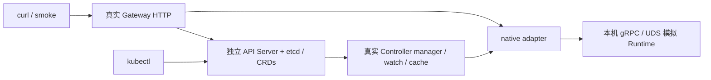

# 测试指南：macOS、Kubernetes 与 Linux/KVM

macOS 可以原生验证 Controller 和 Gateway 到 Runtime 协议边界的完整控制流程。
本仓库提供真实 API Server / etcd、真实 manager watch/cache/reconcile、真实 HTTP
Gateway 和 native gRPC/UDS 模拟 Runtime 的本地环境，无需 Docker、root 或外部集群。
这不包含真实 VM 执行与隔离验证；Rust node 明确要求 Linux 和 `/dev/kvm`。

## 能力矩阵

“协议模拟”表示控制面使用真实网络和 Kubernetes API，但 Runtime 行为由专用模拟器提供。
“未实现”表示当前产品没有这项能力，换到 Linux 也不能直接验证。

| 模块 / 功能 | macOS 原生可以验证 | macOS 原生无法验证 / 额外环境 |
| --- | --- | --- |
| Sandbox / SandboxRuntime API | 真实 CRD 结构、CEL 不可变规则、status、resourceVersion、finalizer | 集群准入链和完整租户权限策略需部署环境验收 |
| Controller | 真实 manager/watch/cache/workqueue、创建意图与绑定、Ready/Unknown、断联恢复、重启复用、TTL 回收、删除确认 | 真正工作负载调度、VM 生命周期副作用由真实后端验证 |
| Gateway | 真实 HTTP 认证、输入校验、异步创建/查询/删除、幂等冲突、Ready/有效期检查、NDJSON 输出 | 完整多租户认证/配额平台尚未实现；本地管理员 kubeconfig 不代表 RBAC 已验证 |
| Native adapter | 真实 gRPC + Unix socket、稳定 ID/hash、协议版本/capability、错误映射、执行终止与截断流 | 模拟器固定输出，不运行命令；真实执行链需 Linux/KVM |
| Rust 核心 | 编译、SQLite、事务、资源分配、重启 quarantine、规则生成、HTTP/frame 解析、mock 生命周期与回滚测试 | Rust node 在 macOS 拒绝启动；Firecracker、TAP、nftables、实际网络策略需 Linux/KVM |
| guest runner | TypeScript 类型检查/构建、protobuf frame 编解码 | 当前自动测试只覆盖 framing；真实 shell/Pi 行为、PID 1、挂载、vsock 与 Linux guest 需另外验收；Pi 调用还需模型凭据 |
| AgentENV / CubeSandbox / E2B adapter | Go httptest 契约：发现/分页、创建不确定性、冲突、删除、Secret 与重定向；AgentENV v0.2.3 Connect execute 与 multipart/raw files | 真实上游版本未验收；AgentENV PTY/端口及 OpenSandbox/CubeSandbox 数据面尚未实现 |
| CRD / Kustomize / 镜像 | CRD 测试、清单渲染；Docker daemon 可用时可构建镜像 | Pod、Service、RBAC、Deployment rollout、leader election 需 Kind 或真实集群 |
| guest 镜像 / VM / 网络隔离 | 配置和逻辑单元测试 | OCI→ext4 镜像脚本要求 Linux/root；启动 VM、vsock、出口网络/拒绝策略、清理泄漏需 Linux/KVM |
| 快照、克隆、预热池、跨节点原生调度、完整 E2B SDK | 未实现 | 需先开发相应能力 |

Mac 上安装 Docker/Kind 可以补测实际 Kubernetes 部署；Docker 的 Linux VM 不保证
提供 `/dev/kvm`，不能据此把 Firecracker 测试标为通过。arm64 Mac 的镜像架构也需与
Linux/KVM 主机、内核、Firecracker 一致。当前 native UDS 只能访问同机节点。

## 测试分层与入口

| 层次 | 命令 | 覆盖与前提 |
| --- | --- | --- |
| L1 快速逻辑 | `make test` | Go、Rust 单测、guest framing/构建、Git 工具；无需 Kubernetes/Docker/KVM |
| L2 控制面联调 | `make test-controlplane` | envtest 真实 API Server/etcd + Controller manager + Gateway + 模拟 Runtime；还包括原有 CRD/恢复测试 |
| L1 + L2 | `make test-mac` | 日常 Mac 一键验证；Linux 也能运行同一套测试 |
| Go 竞态 | `make test-race` | adapter、controller、gateway、模拟器逻辑竞态检查 |
| 清单静态验证 | `make test-manifests` | CRD schema 测试、base/native Kustomize 渲染；需要 kubectl |
| L3 集群部署 | `make kind-up && make kind-smoke` | 部署、Service、RBAC、探针、leader election 和模拟 Runtime 生命周期；不是 Firecracker 验收 |
| L4 真实 Runtime | Linux/KVM 手工验收，见下文 | 实际 VM、guest、网络隔离、资源清理；目前没有声称通过的一键实机测试 |

普通 `make test` 不悄悄跳过测试，也不自动下载/启动集群。L2 缺少资产或启动失败会明确
失败；第一次准备需要网络，后续复用本机缓存。CI 在 macOS 上运行 L1/L2 和 Go race。
Docker/Kind 的 L3 需显式启动，避免无意更改本机 Docker 状态。

## 首次准备

需要 Go 1.26+、Rust stable/Cargo、Node 22.18+（支持原生 TypeScript stripping）、npm、
Python 3.11+、protoc；kubectl 用于手工观察和清单渲染。macOS 可先用你常用的包管理器
安装这些基础工具，例如 `brew install go rust node python protobuf kubectl`。

```sh
make dev-bootstrap
make dev-doctor
make test-mac
```

bootstrap 将固定版本的 Go protobuf 插件与 setup-envtest 放在忽略的 `.tools/bin`，
执行 `npm ci`、生成 Go/guest 协议代码、准备 Kubernetes 1.35.0 的本机 envtest 二进制。
不会启动 Docker、使用 sudo、修改用户 kubeconfig 或安装到全局 Go bin。
Makefile 自动加入 `.tools/bin`；直接运行生成脚本时需自行加入 PATH。
如果只需控制面，可用已有 Go/protoc 插件执行 `make test-controlplane`，无需先安装 guest/npm 依赖。

GitHub 下载不稳定时，可在其他网络下载官方
[envtest 资产](https://github.com/kubernetes-sigs/controller-tools/releases/tag/envtest-v1.35.0)，
按本机 OS/ARCH 选 tar.gz，核对官方 index 中的 hash 后解压，再指定：

```sh
export KUBEBUILDER_ASSETS='/absolute/path/controller-tools/envtest'
make test-controlplane
make dev-up
```

目录应含可执行的 `kube-apiserver`、`etcd`、`kubectl`。Apple Silicon 使用 darwin-arm64，
Intel Mac 使用 darwin-amd64；不要混用 Linux 文件。如果 Go module 访问不通，可设置你
信任的 `GOPROXY` 后重试；脚本不会替你更改全局 Go 配置。

## 长驻联调环境



终端一在仓库根目录运行：

```sh
make dev-up
```

默认 Gateway 为 `http://127.0.0.1:9000`，开发控制端点为 `http://127.0.0.1:9002`。
启动输出会给出四行 `export`：`KUBECONFIG`、`OBSCURA_API_KEY`、
`OBSCURA_GATEWAY_URL`、`OBSCURA_DEV_ADMIN_URL`。复制到终端二，然后：

```sh
make dev-smoke
kubectl -n obscura-dev get sandboxruntimes
kubectl -n obscura-dev get sandboxes -w
```

默认 key 每次启动随机生成，也可在终端一通过 `OBSCURA_API_KEY` 自行设置。
临时 kubeconfig 使用 0600 权限，仅指向此次独立 API Server；开发环境不会读取或切换
已有集群 context。Ctrl-C 会关闭所有组件并删除临时 kubeconfig、socket 和状态，
下一次启动是空环境。envtest 不包含 scheduler/kubelet/controller-manager，不能在其中
运行 Deployment/Pod，也不要依赖 namespace 垃圾回收。该环境以管理员身份测试控制面逻辑，
不覆盖生产 ServiceAccount、RBAC、leader election、Service 路由或启动命令的部署行为。

需要更改端口或在 IDE 中调试时，从仓库根目录运行：

```sh
./scripts/envtest-assets.sh go run ./cmd/devlab \
  --crds=../deploy/crds --listen=127.0.0.1:19000 --admin-listen=127.0.0.1:19002
```

脚本执行命令前会进入 `control/`；devlab 在同一 Go 进程内运行生产 Reconciler、Registry
和 Gateway handler。调试器也可在 `control/` 中启动 `./cmd/devlab`，继承
`KUBEBUILDER_ASSETS` 并传入相同参数。
`make dev-up` 会先生成 `.tools/bin/obscura-devlab` 再直接运行，Ctrl-C 可让进程关闭
它启动的 API Server/etcd；不要用 `go run` 的父进程 PID 强制终止这个长驻环境。

## 手工走一遍生命周期

先复制启动时的四行 export；下面在终端二执行。smoke 会自动创建与清理自己的 CR，
这些手工命令方便停在某一步观察。

```sh
response=$(curl --fail-with-body -sS "$OBSCURA_GATEWAY_URL/v1/sandboxes" \
  -H "X-API-Key: $OBSCURA_API_KEY" \
  -H 'Idempotency-Key: manual-demo-1' \
  -H 'Content-Type: application/json' \
  -d '{"runtimeRef":"local","templateRef":"dev","resources":{"vcpus":1,"memoryMiB":128,"diskMiB":128},"network":{"allowEgress":false},"timeoutSeconds":300}')
printf '%s\n' "$response"
sandbox_id=$(printf '%s' "$response" | python3 -c 'import json,sys; print(json.load(sys.stdin)["sandboxID"])')

kubectl -n obscura-dev wait --for=condition=Ready "sandbox/$sandbox_id" --timeout=30s
kubectl -n obscura-dev get sandbox "$sandbox_id" -o yaml

curl --fail-with-body -sS -N "$OBSCURA_GATEWAY_URL/v1/sandboxes/$sandbox_id/execute" \
  -H "X-API-Key: $OBSCURA_API_KEY" -H 'Content-Type: application/json' \
  -d '{"command":"echo hello","timeoutSeconds":5}'

curl --fail-with-body -sS -X DELETE "$OBSCURA_GATEWAY_URL/v1/sandboxes/$sandbox_id" \
  -H "X-API-Key: $OBSCURA_API_KEY"
kubectl -n obscura-dev wait --for=delete "sandbox/$sandbox_id" --timeout=30s
```

执行输出包括 started、stdout 和 result；stdout 为 `simulated: echo hello`，**不会在宿主机
执行 shell**。传 `demo:fail` 返回 error 事件。不能用此模拟器验证实际命令结果、内存/CPU
约束、网络策略、磁盘隔离或 Rust 进程恢复。

## 故障注入与恢复

开发控制端点只监听 loopback，要求同一 API key，不编入生产镜像。faults 请求设置完整
故障状态，省略字段按 false 处理；不要对真实 Runtime 使用这些端点。

```sh
# 查看累计创建数、活跃 ID、执行次数和当前故障
curl -sS "$OBSCURA_DEV_ADMIN_URL/state" -H "X-API-Key: $OBSCURA_API_KEY"

# Runtime 断联：已有实例变为 Unknown，绑定和活跃 ID 保留
curl -sS -X POST "$OBSCURA_DEV_ADMIN_URL/faults" \
  -H "X-API-Key: $OBSCURA_API_KEY" -H 'Content-Type: application/json' \
  -d '{"unavailable":true}'

# 恢复连接：应回到 Ready，而非创建第二份实例
curl -sS -X POST "$OBSCURA_DEV_ADMIN_URL/faults" \
  -H "X-API-Key: $OBSCURA_API_KEY" -H 'Content-Type: application/json' -d '{}'

# 阻塞后端删除，再从 Gateway 删除一个 Ready sandbox
# 应停留 Terminating，CR 保留 deletionTimestamp 和 runtime-cleanup finalizer
curl -sS -X POST "$OBSCURA_DEV_ADMIN_URL/faults" \
  -H "X-API-Key: $OBSCURA_API_KEY" -H 'Content-Type: application/json' \
  -d '{"holdDeletes":true}'

# 清除 faults 后再观察 CR 被删除
curl -sS -X POST "$OBSCURA_DEV_ADMIN_URL/faults" \
  -H "X-API-Key: $OBSCURA_API_KEY" -H 'Content-Type: application/json' -d '{}'

# 重建 Controller manager/cache/workqueue，保留 API 与模拟 Runtime 状态
curl -sS -X POST "$OBSCURA_DEV_ADMIN_URL/controller/restart" \
  -H "X-API-Key: $OBSCURA_API_KEY"
```

`make test-controlplane` 自动覆盖上述故障及重启，同时验证 CEL 拒绝修改 Sandbox spec。
这里的 controller 重启是同进程重建 manager；不是 Rust node 重启、API Server 重启或
真实 VM 接管验证。真实 Rust daemon 重启的 quarantine 语义见 Runtime 契约。

## Docker Compose 与 Kind

需要 Docker daemon、Kind、kubectl、curl、rg，以及构建脚本使用的 Python 3.11+。`compose.yaml`
是独立的 Linux 容器测试入口：

```sh
docker compose run --build --rm control-tests
```

它使用 [control/Dockerfile](../control/Dockerfile) 的 `control-tests` 构建阶段，在
容器里执行 `make test-controlplane`。envtest 在容器内启动自己的 API Server/etcd；
Compose 不启动 Kubernetes 集群，也不会验证 Deployment、Service、RBAC。首次运行需
联网下载 Go 依赖和 Linux envtest 二进制。2026-10-15 已在 Docker Desktop Linux/arm64
验证该命令通过。生产镜像由同一个 Dockerfile 的最终阶段
构建，仅包含 `controller` 和 `gateway`；Dockerfile 的 `devruntime` target 单独生成
`obscura-devruntime:dev`，仅 Kind overlay 使用。模拟器不执行命令、不创建 VM。
Compose 用 `envtest-cache` volume 保留 Linux API Server 二进制；`--rm` 只删除本次测试
容器，不删除缓存 volume。需要彻底清理这套 Compose 环境时用 `docker compose down -v`。
构建使用标准 `GOPROXY`，网络无法连接默认代理时可仅对这次命令设置
`GOPROXY=https://goproxy.cn`；依赖校验仍保持开启。
如果容器访问 GitHub release 失败，可先取得官方 `envtest-v1.35.0-linux-arm64.tar.gz`
（Intel Docker 主机改为 linux-amd64），核对官方 hash 后用
`docker run --rm -i -v obscura_envtest-cache:/root/.local/share/kubebuilder-envtest \
--entrypoint /bin/sh obscura-control-tests:latest -c 'cd /src/control && go install
sigs.k8s.io/controller-runtime/tools/setup-envtest@v0.0.0-20260305142021-f9589b9f2b9d
&& /go/bin/setup-envtest sideload 1.35.0' < envtest-v1.35.0-linux-arm64.tar.gz`
导入缓存，再重跑 Compose。不要把 macOS 的 envtest 可执行文件挂进 Linux 容器。

需要真实 Pod、Service、RBAC 与镜像验收时，使用专用 Kind 集群：

```sh
make kind-up
make kind-status
make kind-smoke
# 本机 kubeconfig 保存在 .tools/kind-kubeconfig，脚本始终显式指定它
kubectl --kubeconfig .tools/kind-kubeconfig --context kind-obscura-test \
  -n obscura-system get pods,sandboxruntimes,sandboxes
# 用完后显式删除该专用集群
make kind-down
```

`kind-up` 创建或复用名称为 `obscura-test` 的单节点 Kubernetes 1.35 集群，不触碰
已有 Kind 集群或默认 kubeconfig。脚本构建 `obscura-control:dev` 和独立的
`obscura-devruntime:dev`，载入节点，安装 CRD、
Namespace、ServiceAccount/RBAC、三套 Deployment、Service、Secret 和 `SandboxRuntime`
示例。随机 API key 保存在 0600 的 `.tools/kind-api-key`；重新运行 `kind-up` 可更新
镜像和部署，但有活跃 Sandbox 时会拒绝重启内存模拟器。已有同名集群但缺少本项目
kubeconfig 时脚本拒绝接管。
Docker registry 临时不可达但两张本地镜像已构建时，可用
`OBSCURA_SKIP_BUILD=1 make kind-up` 重新载入现有镜像；该选项不包含新代码。

`deploy/overlays/kind` 复用生产 Controller/Gateway 清单，并在同一 Kind 节点额外启动
devruntime Pod。三者通过节点内 `/run/obscura/node.sock` 通信；模拟器使用 hostPath
只服务该临时测试集群，不能用于生产隔离。`kind-smoke` 临时 port-forward Gateway 至
`127.0.0.1:19000`，跑认证、幂等、Ready、执行流、删除与 TTL 回收，结束即关闭
port-forward。可用 `OBSCURA_KIND_PORT` 更换本地端口。Kind 中的执行输出仍是固定模拟文本。
上文的手工生命周期示例针对 envtest 的 `obscura-dev` 命名空间；在 Kind 中手工
观察实例时，应使用 `.tools/kind-kubeconfig`、`kind-obscura-test` context 和
`obscura-system` 命名空间。Gateway API key 存在 `.tools/kind-api-key`。

该测试还能用 `kubectl auth can-i --as=system:serviceaccount:obscura-system:obscura-controller ...`
核对权限，并观察探针、Service 与 leader election。Kind 运行在 Docker Linux VM 内，
通常不能得到可用 `/dev/kvm`，因此不能替代下一节的真实 Runtime 验收。

## Linux/KVM 验收清单

按根 README 启动真实 Rust node；按 [Kubernetes 使用说明](kubernetes.md) 配置同机 UDS
或 native overlay。预先检查 `/dev/kvm` 可读写、架构一致、Firecracker、内核、rootfs、
`iproute2`、`nftables`、`mkfs.ext4`、转发配置及宿主权限。

1. 创建真实 Sandbox，从 Gateway Ready 到执行命令；验证 stdout/stderr、非零退出、输入/环境和超时。
2. 验证 guest vsock/protobuf；输出来自 guest，不能只检查控制面返回状态。
3. 验证默认拒绝出口、显式出口允许，以及不同沙箱的磁盘/进程/网络隔离和资源限制。
4. 删除与 TTL 回收后，核对 Firecracker 进程、TAP、nft 规则、磁盘、SQLite 绑定，不应只看 CR 消失。
5. 测试创建失败/丢响应/中途崩溃与 controller 重启；真实 node 重启应隔离旧实例，按契约人工审计，不能声称自动接管。
6. AgentENV/CubeSandbox 单独固定上游版本，验收发现/分页、创建不确定性、删除确认及策略限制；AgentENV 还要实测 Connect 执行、stdin/close、取消、截断流和二进制文件往返。

未完成真实部署准入的 HTTP provider，以及 PTY、快照/克隆/预热池，不列为环境失败，
应作为功能缺口追踪。AgentENV execute/files 只有通过上述实机 smoke 后才能从协议测试
状态提升为已准入。

## 验证记录

2026-10-16，在 Apple Silicon macOS 上：`make test-go protocol-check` 和
`cd control && go test -race ./internal/backend -count=1 -timeout=90s` 通过。
AgentENV v0.2.3 的 HTTP 协议模拟覆盖 Connect framing、启动后发送 stdin、输入输出
并发、输入失败中断输出且不误报成功、HTTP 取消、token 路由、错误脱敏和二进制文件
上传下载。生成脚本包含 envd protobuf message binding，不生成未使用的 gRPC stub。
真实 AgentENV 部署、远端进程终止、OpenSandbox/CubeSandbox 数据面未在本轮验收；
对应 provider 仍未开放 Registry。AgentENV 本机 checkout 的 pull/fetch 多次因
GitHub HTTPS 超时未完成，源码校对使用已核对 tag/commit 的 v0.2.3 release 源码。

2026-10-15，在 Apple Silicon macOS 上：`make test`、`make test-controlplane`、
`make kind-up`、`make kind-smoke`、`docker compose run --build --rm control-tests`
通过，三个 Kind Deployment 与 Service Ready。
其中真实 API Server / etcd 使用 Kubernetes 1.35.0 darwin-arm64；控制面联调覆盖真实
manager 与 HTTP/gRPC 链路。Linux/KVM 和上游真实
沙箱验收不在本次通过范围。后续记录请保留平台、命令、版本与未验证项，避免把协议模拟
描述为真实 VM 端到端测试。
